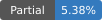
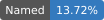
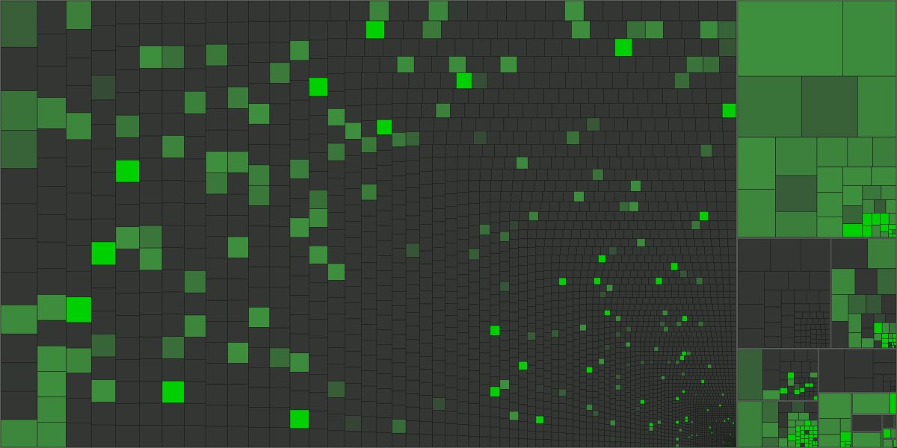
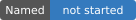

# SFC2-decomp

A matching decompilation of **Star Trek: Starfleet Command II**: the game's code recovered as
readable C++, function by function, and verified byte for byte against the original executable
with the original compiler.

No game file is in this repository. You bring your own retail install; the tools read it in
place and never write to it.

**Want to help?** Read [CONTRIBUTING.md](CONTRIBUTING.md): how to set up, claim a unit and send it.


## Orion Pirates (2.5.5.2)

  



Each rectangle is one translation unit of the original game, sized by its code. Bright green: every
function in it is rebuilt byte-exact. Dark grey shading toward green: the share of its bytes
matched so far. Library code (C runtime, STL and the like) is left out. The figures are the
game-only ones in [PROGRESS.md](analysis/results/progress/op/PROGRESS.md):

- **Exact:** game code rebuilt byte for byte with the original compiler, as a share of game code
  bytes.
- **Partial:** game code written and scored but not yet byte-exact, as a share of game code bytes.
  A consumer still runs the original's code for it.
- **Named:** game functions with a real symbol, as a share of game functions. The symbol comes
  from the SDK, from Ghidra's function ID, or from the claim that writes the function in `op/`,
  unless that claim still uses a placeholder such as `fn_00401000`.

## Empires at War

  

Not started. Orion Pirates is built on Empires at War, and most of their engine code is the same;
`eaw/README.md` says how that code will be shared.

## Layout

| Path | What it is |
| --- | --- |
| `op/` | Orion Pirates' code, kept as the original wrote it, with `op/UNITS.tsv` (one row per translation unit) and `op/manifest.tsv` (every claimed function and its build mode) |
| `eaw/` | Empires at War's code, once it starts |
| `harness/` | the build-and-verify loop: compiles a unit with the pinned compiler and scores each function against the original with objdiff |
| `toolchain/` | the pinned compiler (Visual C++ 6.0 SP4, run in a container under wibo) and its calibration |
| `ghidra/` | the analysis exports every tool reads (function list, classes, vtables) and the scripts that make them |
| `analysis/results/` | the matched set, the SDK symbol matches, the known boundary errors, the hashes of the retail files and the progress figures |
| `tools/`, `scripts/` | the manifest and unit-map generators, the progress report and charts, the checks |

The one contract with programs that build on this code is [docs/INTERFACE.md](docs/INTERFACE.md).

## Getting started

You need your own Orion Pirates install patched to 2.5.5.2 (its modding SDK comes with it),
Docker, and Python 3.9 or later with pytest, on one of these
([CONTRIBUTING.md](CONTRIBUTING.md#what-you-need) has the details):

- macOS on Apple silicon: tested, with the native compiler;
- Linux x86-64: the compiler in the Docker image; untested;
- Windows: WSL2 with a Linux distribution and Docker, then the Linux steps; untested.

Linux and Windows have not been run end to end.
Clone into a folder of its own: generated data and downloaded tools go in `work/` and `tools/`
beside the clone.

```bash
mkdir sfc2 && cd sfc2
git clone https://github.com/marinohardin/SFC2-decomp.git && cd SFC2-decomp
sh scripts/setup.sh --install "/path/to/Starfleet Command Orion Pirates"
sh scripts/check.sh
```

`setup.sh` checks your install's files against the known hashes, builds the compiler image from
public downloads and fetches objdiff. `check.sh` is the definition of done: the tests, the
progress gate and the matched-set gate, which rebuilds every matched function and checks that
none got worse.

To work on a function, read `harness/README.md` and `harness/SRC_LAYOUT.md`, then:

```bash
sh harness/build-and-verify.sh <unit or address>
```

## Contributing

Outside contributors, and coding agents working for them, start with
[CONTRIBUTING.md](CONTRIBUTING.md). `AGENTS.md` holds the owner's own roles and rules;
`docs/CONVENTIONS.md` says how the source is written. Pull requests go to `develop`.

## Status and legal

This repository contains no retail executable, library or asset, and nothing derived from one
byte for byte. Every name in the source comes from the game's own executable, its modding SDK, or
this project. The licence is not yet decided. Star Trek and Starfleet Command are trademarks of
their respective owners; this is an unaffiliated preservation project.
